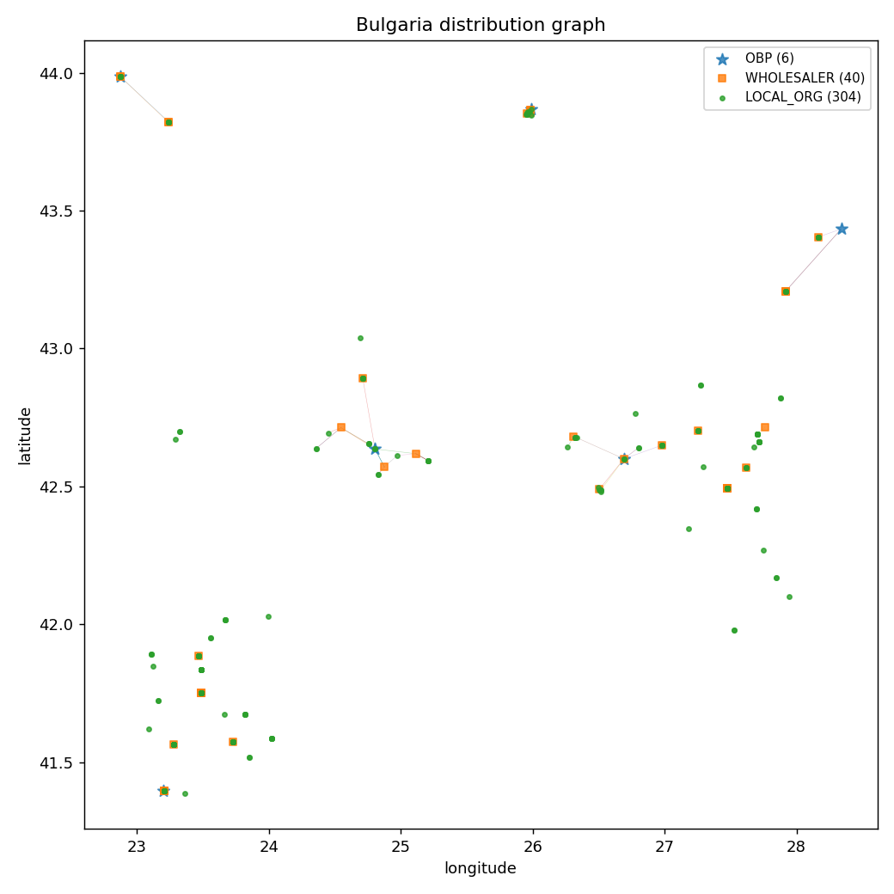
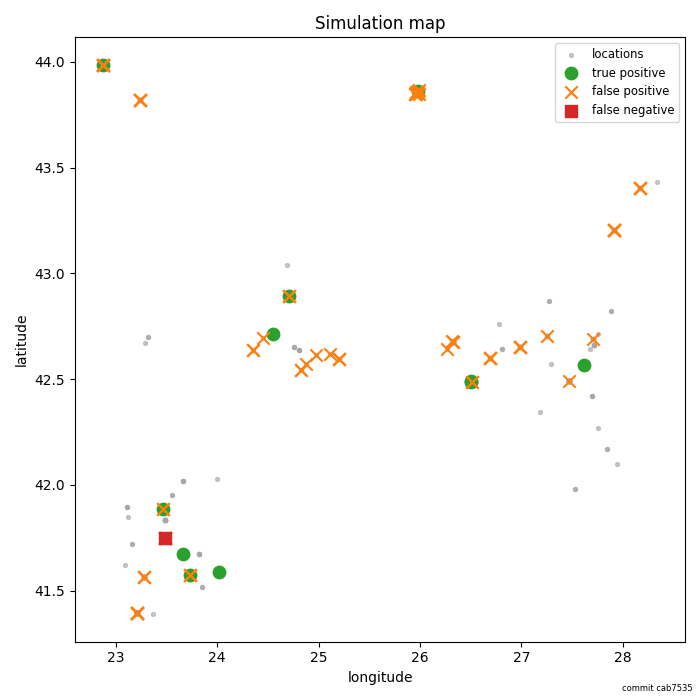
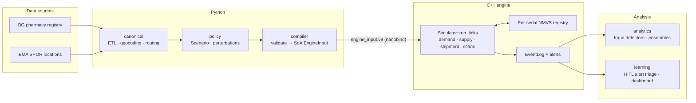
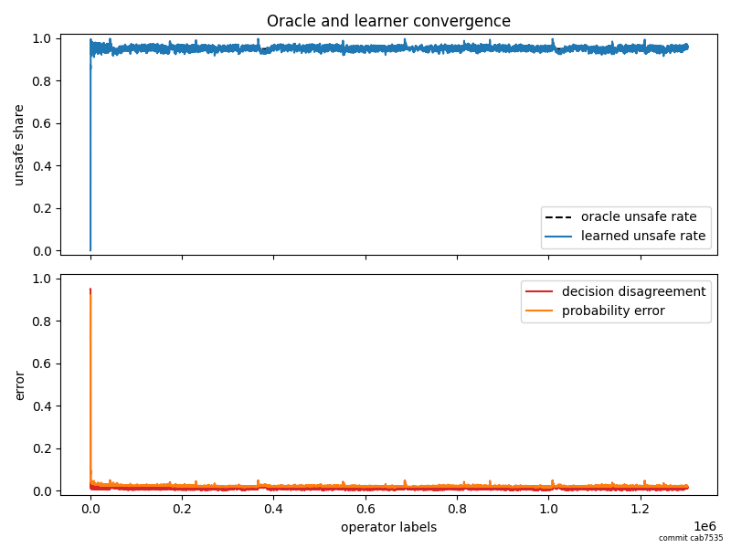

<div align="center">

# PharmaSim

**An agent-based simulator of EU pharmaceutical distribution for studying theft, smuggling and counterfeiting under the Falsified Medicines Directive.**


</div>

PharmaSim models the physical supply chain (manufacturers/OBPs → wholesalers → pharmacies and hospitals) **and** the EU's serialisation layer (EMVS / national NMVS registries) side by side. Because the registry is updated only by scan transactions, it can drift from physical reality, and that drift is exactly where fraud becomes visible. Fraud scenarios are injected into a calibrated network built from **real Bulgarian registry data**. They produce genuine FMD alerts in the engine's event log, and those alerts feed both rule-based detectors and a **human-in-the-loop alert-triage learner**.

<p align="center">
  
  
</p>
<p align="center"><sub>Left: geocoded Bulgaria network (6 OBP hubs, 40 wholesalers, 304 pharmacies/hospitals). Right: locations flagged from the alert stream compared with the injected fraud sites.</sub></p>

## Highlights

- **Fast C++20 kernel.** It uses a struct-of-arrays (SoA) memory layout, a phased tick loop, multi-hop shipping over a precomputed route CSR (compressed sparse row) table, and an append-only event log. It is exposed to Python via `nanobind`, loading each NumPy column with a single copy, and scales to multi-million-pack stress scenarios.
- **A realistic EMVS / NMVS registry.** Each market keeps a per-serial registry with `VERIFY` / `DECOMMISSION` / `REACTIVATE` semantics, the FMD reactivation window, and typed alerts (`UNKNOWN_SERIAL`, `OUT_OF_MARKET`, `ALREADY_DECOMMISSIONED`, `DUPLICATE_SERIAL`).
- **Real-world data pipeline.** Inputs are the Bulgarian pharmacy registry (3,958 entities) and EMA SPOR locations (78k rows), with resumable OpenStreetMap geocoding, a connectivity-first network build, and `scipy.sparse.csgraph` routing.
- **Fraud as perturbations of the real engine.** Counterfeit injection, cross-market smuggling, distributor theft and volume spikes rewrite the calibrated engine inputs. Ground-truth labels are kept separate from what the detectors see.
- **Human-in-the-loop alert learning.** An online logistic learner recovers a hidden operator rule set from triage feedback alone. With uncertainty sampling it requests labels for only about 3.5 % of cases at essentially the same F1 as labelling everything.
- **Supervisor dashboard.** A Streamlit walkthrough shows the network, the layered alert triage with pack histories, the learning curves, and a concrete EMVO/NMVS data request.

## Architecture



Python owns the policy, data and experiments; C++ owns the hot loop. The boundary is a single versioned columnar ABI (`engine_input.v8`), so you rarely need to touch the C++ side to run experiments.

## Quickstart

**Prerequisites:** [uv](https://docs.astral.sh/uv/), CMake ≥ 3.24, Ninja, and a C++20 compiler.

```bash
./scripts/setup.sh          # uv sync + CMake/Ninja build of the _pharmasim_native extension
uv run pytest -m "not slow" # fast test suite
uv run pytest               # including the larger Bulgaria ensembles
```

A minimal synthetic run:

```python
from compiler.compile import compile_scenario
from policy.scenarios import two_markets_demo
from runtime.native_bridge import create_native_simulator
from runtime.simulation_viz import export_run_report

inp = compile_scenario(two_markets_demo())
sim = create_native_simulator(inp)
sim.run_ticks(500)
print("tick", sim.current_tick(), "events", sim.event_count())
export_run_report(sim, inp, "out_logs", prefix="run")  # CSV / JSONL / final snapshot
```

The test suite and scripts put `python/` on the path. For ad-hoc runs, use `PYTHONPATH=python uv run python ...`.

## Workflows

### 1. Bulgaria end-to-end simulation

```bash
uv run python scripts/geocode_bg.py   # one-time, resumable; fills data/geocode_cache_bg.json
TICKS=300 ./scripts/run_bulgaria.sh   # build → compile → calibrate → simulate → out_logs/
```

### 2. Fraud experiment (baseline vs. perturbed)

```python
from analytics.experiment import run_fraud_experiment
from policy.perturbations import PerturbationSpec, PerturbationType

result = run_fraud_experiment(PerturbationSpec(ptype=PerturbationType.SMUGGLING))
print(result.metrics)  # precision / recall / F1 against injected ground truth
```

| Perturbation | What it does to the engine | Signal in the event log |
| --- | --- | --- |
| `COUNTERFEIT` | Injects packs with fabricated serials | `UNKNOWN_SERIAL` alerts |
| `SMUGGLING` | Diverts a node into a foreign market | `OUT_OF_MARKET` alerts |
| `THEFT` | Distributor shrinkage | `STOLEN`-coded decommissions |
| `VOLUME_SPIKE` | Legitimate demand surge (a control case) | Transaction-volume change only |

`analytics.ensemble` runs the same loop across many seeds, reports metric distributions with confidence intervals, and sweeps detector thresholds without re-simulating.

### 3. Human-in-the-loop alert learning

A hidden operator policy (`configs/hitl/operator_rules.v1.json`) labels alerts as safe or unsafe. It is modelled on rules from the Bulgarian Drug Agency: same-town swaps are benign, hospital-to-hospital moves are suspicious, and low-trust actors are flagged. The learner sees only alert features and feedback, never the rule IDs or the perturbation labels.

```bash
uv run python scripts/run_hitl_demo.py \
  --scenario bulgaria --ticks 300 --seeds 1,2,3,4,5 \
  --perturbations COUNTERFEIT,SMUGGLING,THEFT,VOLUME_SPIKE \
  --query-policy all --mode oracle --safe-sample-rate 0.5 \
  --output artifacts/hitl_demo/supervisor

uv sync --extra dashboard
uv run python scripts/run_hitl_dashboard.py --artifact-dir artifacts/hitl_demo/supervisor

uv run python scripts/run_hitl_acceptance.py --ticks 300 --seeds 1,2,3,4,5 \
  --output artifacts/hitl_acceptance   # five-fold, two-policy check; non-zero exit on failure
```

The last seed is held out for evaluation. Outputs include `cases.jsonl`, `feedback.jsonl`, `metrics.json`, model weights and checkpoints, seven plots, and the dashboard's `network.json`, `pack_traces.jsonl` and `calibration.json`. `--mode human` replaces the oracle with labelling prompts in the terminal.

**Latest acceptance run** (5 seeds × 4 perturbations, 300 ticks, ≈6.5 M alert cases):

| Query policy | Labels requested | F1 | Precision | Recall | False-positive rate |
| --- | ---: | ---: | ---: | ---: | ---: |
| Query all | 6,471,704 (100 %) | 0.994 | 0.989 | 0.999 | 0.219 |
| Uncertainty sampling | 226,131 (3.5 %) | 0.995 | 0.992 | 0.998 | 0.159 |

Six of the seven acceptance criteria pass. These include the F1 target on every held-out seed and the requirement that uncertainty sampling uses at most half the labels while staying within 0.05 F1 of query-all. The false-positive-rate target (≤ 0.10) is **not yet met**. Most of the stream is unsafe, so the few safe alerts are hard to learn; this is the main open item.

<p align="center"></p>

## Simulation kernel

Each `Simulator::run_ticks` step (1 tick ≈ 1 day) runs four phases:

1. **Demand.** Terminals draw demand from a `policy_id`: none, constant rate, or Poisson.
2. **Supply.** Wholesalers replenish toward their preferred edge when there is downstream backlog. OBPs activate pool stock and ship. Per-edge capacity is enforced within the tick.
3. **Shipment.** Due moves advance along edges using the precomputed multi-hop route CSR and per-edge lead times.
4. **Pack behaviour.** Packs are verified, decommissioned or reactivated against the scan location's national NMVS:
   - `VERIFY` raises typed alerts.
   - `DECOMMISSION` records a reason (Dispensed, Stolen, Exported, Destroyed, Sampled, Locked or Recalled) and opens the reactivation window.
   - `REACTIVATE` is accepted only inside that window.

`registry_matches_physical()` is a ground-truth consistency check that fails under clones or unreported shrinkage.

**ABI rule:** when you add or reorder `EngineInput` columns, keep `python/compiler/types.py` and `cpp/engine/enums.hpp` in sync, load the new fields in `cpp/bindings/`, then rebuild with `./scripts/setup.sh`.

## Benchmarks

The benchmarks time the pipeline in four phases: `build_scenario`, `compile_scenario`, `create_simulator` and `run_ticks`.

```bash
PHARMASIM_BENCH_PROFILE=quick    uv run pytest tests/bench.py -v   # sub-second sanity check
PHARMASIM_BENCH_PROFILE=bulgaria uv run pytest tests/bench.py -v   # registry scale
PHARMASIM_BENCH_PROFILE=stress   uv run pytest tests/bench.py -v   # 4 markets × 1M packs (slow)
```

The stress profile can be tuned with `PHARMASIM_BENCH_TICKS`, `_MARKETS`, `_LOCATIONS`, `_PACKS` and `_PRECOMPUTED_EDGES`. Large builders skip `LocationEdge` objects entirely by passing `edge_*` NumPy columns straight to `compile_scenario`.

## Repository layout

```text
cpp/engine/          C++ kernel: state, phased tick loop, NMVS registry, event log
cpp/bindings/        nanobind module (_pharmasim_native)
python/canonical/    Data loaders, OSM geocoding, routing, Bulgaria scenario builder, ATC substitutability
python/policy/       Scenario model, synthetic/large scenarios, fraud perturbations
python/compiler/     Validation and Scenario → columnar EngineInput compile
python/runtime/      Native bridge, Bulgaria calibration helpers, export & plotting
python/analytics/    Log-based fraud detectors, experiments, Monte Carlo ensembles
python/learning/     HITL alert cases, operator oracle, online learner, query policies, dashboard
configs/hitl/        Demo and operator-rule configs
data/                BG registry, EMA SPOR locations, geocode cache, product catalogue
docs/                HITL spec, EMVO data request, calibration statistics, figures
scripts/             Setup, run, geocoding and HITL entry points
tests/               pytest suite and benchmarks
```

Generated outputs (`out_logs/`, `artifacts/`, `build/`) are git-ignored and can be regenerated with the scripts above.

## Documentation

- [HITL learning specification](docs/hitl_learning_spec.md): design and acceptance criteria of the alert-learning loop.
- [EMVO / NMVS data request](docs/emvo_data_request.md): which aggregates would calibrate which engine parameters.
- [Calibration statistics](docs/calibration_stats.md): descriptive statistics to collect.
- [TODO](TODO.md): model gaps, data to collect, calibration workflow.

## Roadmap

- Calibrate against real NMVS transaction aggregates; fit detector thresholds from baseline tails.
- Fan-out supply allocation (the engine currently ships along one preferred edge per node).
- Explicit EMVO upload/provisioning lifecycle and NMVO/EMVO organisations.
- Multi-product scenarios with ATC-based substitutability.
- Per-tick anomaly injection inside the engine, and richer order/transaction semantics in the log.
- Lower the HITL false-positive rate with class-balanced learning and a richer feature set.

## Contact

Han Wu: [hanwuh@ethz.ch](mailto:hanwuh@ethz.ch). ETH Zürich, *ABM for EU Pharmaceutical Distribution*.
